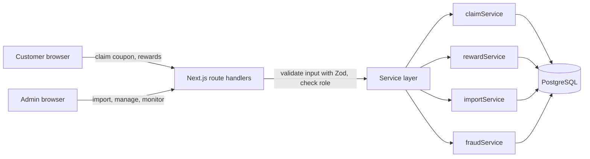
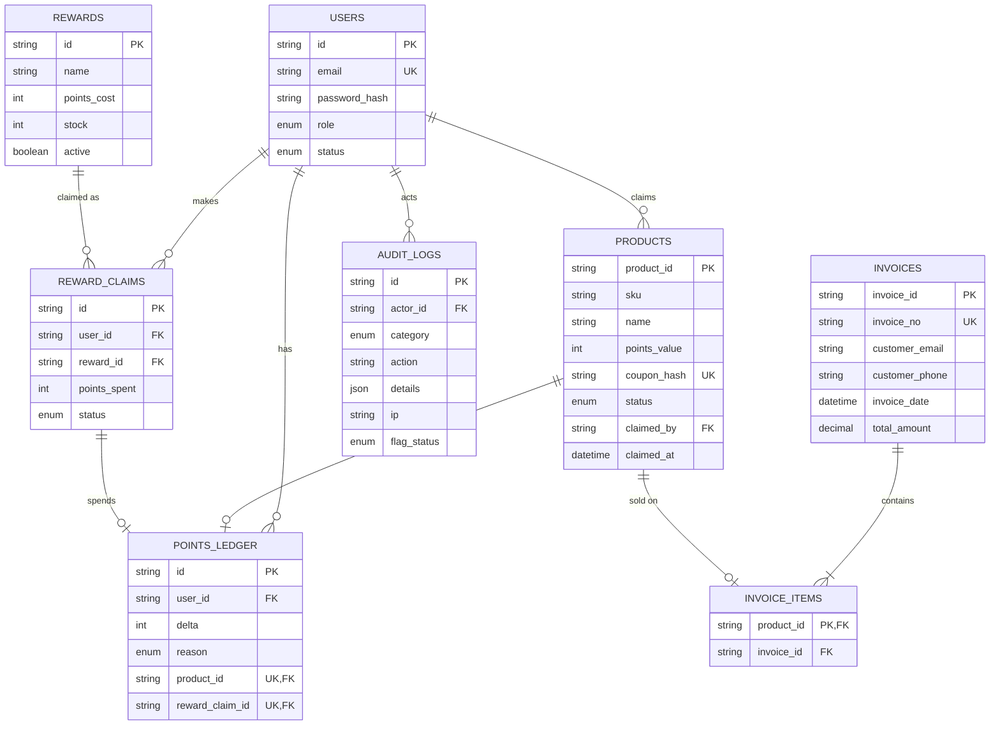
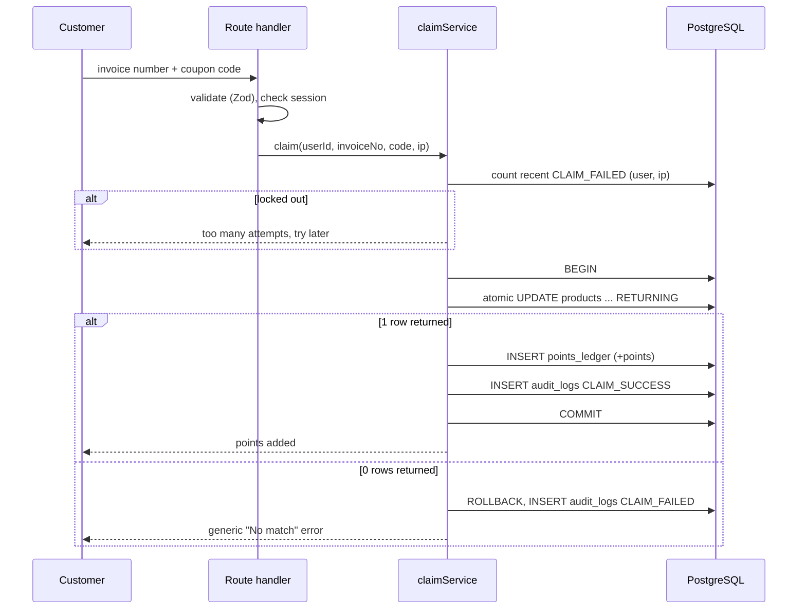
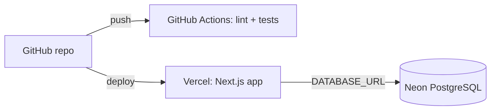

# ARCHITECTURE.md: LoyalStamp

## 1. Overview

LoyalStamp lets a factory run a loyalty program for boxed products. A customer proves a purchase with an **invoice number plus the coupon code inside the box**, earns points, and spends them on rewards. The owner manages data and monitors the program from an admin dashboard.

Proof of purchase is two-factor:

| Factor | Proves | Stops |
|---|---|---|
| Invoice number | A real sale exists and lists this product unit | Using a coupon with no matching sale |
| Coupon code | The box was physically opened | Using an invoice number copied from someone |

## 2. Stack and reasons

| Layer | Choice | Reason |
|---|---|---|
| Framework | Next.js (TypeScript) | One codebase and one deployment for customer UI, admin UI and API. TypeScript catches type errors early. |
| Database | PostgreSQL | Real transactions and unique constraints, which the anti-fraud logic depends on. |
| ORM | Prisma | Typed schema, migrations, and `$queryRaw` for the one atomic claim query. |
| Validation | Zod | Every input is validated on the server. |
| Auth | Email and password (hashed), signed session, role check (`CUSTOMER` / `ADMIN`) | Simple and defensible. OTP is a future upgrade. |
| UI | Tailwind CSS, Recharts | Fast dashboards with little custom CSS. |
| Tests | Vitest | Fast integration tests, including the concurrency test. |
| CI/CD | GitHub Actions | Runs lint and tests on every push. |
| Hosting | Vercel + Neon Postgres | Free tier and a public link. |

**Alternative considered:** React + Express/FastAPI. It works, but means two projects and two deployments for no gain here.

## 3. System diagram



**Layering rule:** route handlers only validate input, check the session and role, and call a service. All business logic lives in `src/services/` so it can be tested without the UI.

## 4. Data model



The full definition is in `prisma/schema.prisma`.

### Tables

| Table | Purpose |
|---|---|
| `users` | Accounts, role and status (`ACTIVE` / `BANNED`). |
| `products` | **One row per physical box.** Holds the hashed coupon, points value, and claim status. |
| `invoices` | One row per invoice: number, customer contact, date, total. |
| `invoice_items` | Links an invoice to the units sold on it. `product_id` is the primary key, so a unit is on at most one invoice. |
| `points_ledger` | Append-only. Balance = sum of `delta`. |
| `rewards` | Reward catalog with points cost and stock. |
| `reward_claims` | A customer's reward request, from `PENDING` to `FULFILLED` or `CANCELLED`. |
| `audit_logs` | Audit trail, fraud flags (`category = FRAUD_FLAG`) and failed attempts for rate limiting. |

### Design decisions

- **No coupon table.** The coupon is a field on the product row because each box is its own row (ASSUMPTIONS A5).
- **Coupons are hashed.** Only an HMAC-SHA256 of the code is stored, using a server secret, so a database leak does not expose usable coupons.
- **Ledger instead of a balance column.** A stored balance can drift. The ledger is append-only and can always be audited.
- **Database-level guards.** `coupon_hash` is unique. `points_ledger.product_id` is unique, so even a bug in the application cannot credit the same unit twice.
- **Fraud flags and failed attempts share `audit_logs`.** This avoids two extra tables. The lockout is computed by counting recent `CLAIM_FAILED` rows, which also works on serverless hosting, where an in-memory rate limiter does not.

## 5. Claim flow



### The atomic claim query

```sql
UPDATE products p
SET status = 'CLAIMED', claimed_by = :user_id, claimed_at = now()
FROM invoice_items ii
JOIN invoices i ON i.invoice_id = ii.invoice_id
WHERE p.coupon_hash = :coupon_hash
  AND p.status = 'UNUSED'
  AND ii.product_id = p.product_id
  AND i.invoice_no = :invoice_no
RETURNING p.product_id, p.points_value;
```

- **One statement does the whole check:** coupon exists, is unused, and its unit is on that invoice.
- **Race-safe:** two simultaneous requests cannot both change the row from `UNUSED`. One gets a row back and the other gets zero.
- **Generic error:** zero rows gives the same "No match" message whatever the cause, so attackers learn nothing.

## 6. Fraud controls

| Threat | Control |
|---|---|
| Coupon reuse | Status flips to `CLAIMED` atomically. The unit is credited at most once (unique ledger `product_id`). |
| Race condition (parallel claims) | Conditional `UPDATE ... WHERE status = 'UNUSED'` inside one transaction. Proven by a concurrency test. |
| Stolen invoice number | Useless without a matching unused coupon. |
| Coupon used on the wrong invoice | The unit must appear on that invoice. |
| Brute-force guessing | Failed attempts counted per user and IP. Lockout after N failures. Generic errors. |
| Database leak | Coupons stored as HMAC hashes. Passwords hashed. |
| Suspicious behaviour | Flags (many failures, many accounts per IP, high volume) go to the admin review queue. |
| Insider or admin mistakes | Every admin action is written to `audit_logs`. |

**Known limit:** someone holding both the invoice number and the coupon from the same box is treated as the buyer. Fraud is greatly reduced, not eliminated (ASSUMPTIONS A28).

## 7. Security basics

- Passwords hashed with bcrypt or argon2.
- Session token signed with `AUTH_SECRET`, stored in an httpOnly cookie.
- Role check on every admin route and every admin API handler.
- Zod validation on all inputs. Prisma parameterises queries, including the raw claim query.
- Secrets only in environment variables. `.env.example` holds placeholders.

## 8. Deployment



Environment variables on Vercel: `DATABASE_URL`, `CODE_HMAC_SECRET`, `AUTH_SECRET`, plus the rate-limit settings. Migrations run with `prisma migrate deploy`.

## 9. Trade-offs

| Choice | Benefit | Cost |
|---|---|---|
| One product row per box | No coupon table, one-query claim | Name and points repeat on every unit |
| Fraud flags inside `audit_logs` | Fewer tables | Admin queries filter by `category` |
| DB-based rate limiting | Works on serverless | Extra read on each claim attempt |
| Manual reward fulfilment | Fits any factory | Admin must mark claims fulfilled |
